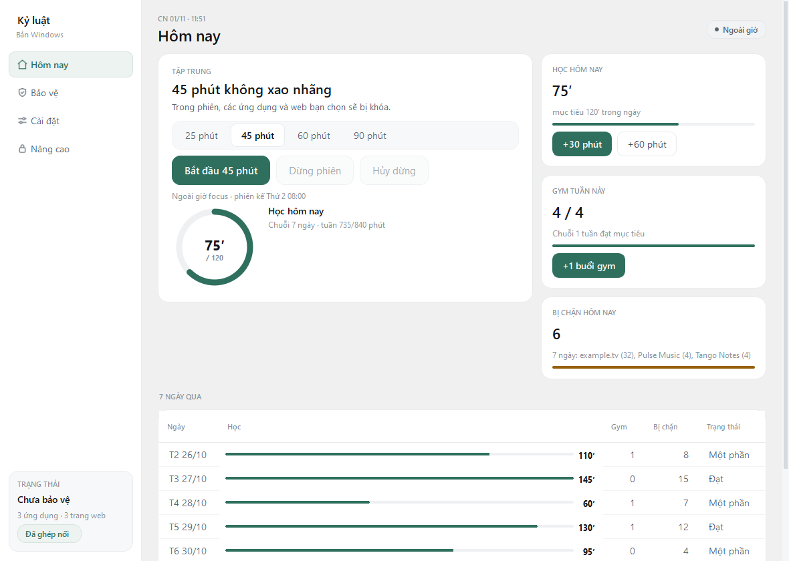
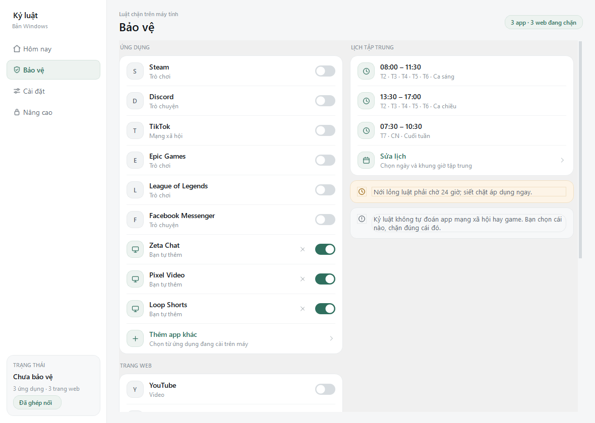

# Kỷ luật

Kỷ luật là máy chặn xao nhãng gồm bốn phần: một tiến trình nền Python và PySide6 trên Windows, một DNS sinkhole local chặn tên miền, một app Android phủ màn khoá lên ứng dụng đang mở, và trang web hướng dẫn cùng tải về viết bằng Next.js. Mã nguồn ở [github.com/HairBaconGamming/kyluat](https://github.com/HairBaconGamming/kyluat); nơi duy nhất phát hành bản dùng được là [GitHub Releases v1.0](https://github.com/HairBaconGamming/kyluat/releases/tag/v1.0). Trang web chưa có URL công khai, nó mới chạy nội bộ bằng `npm run dev` và chờ được deploy từ repo này.



Ảnh trên và ảnh dưới dùng dữ liệu demo, không phải lịch sử thật của ai.

## Luật bản hiện tại

| Việc | Bản này |
| --- | --- |
| Quỹ mạng xã hội mỗi ngày trên Android | mặc định 60 phút, trừ ngay khi bạn mở app trong danh sách, làm mới lúc 0 giờ, không có nút gia hạn trong ngày |
| Điểm học thưởng thêm quỹ trên Android | phiên tập trung hoàn thành 25/45/60 phút = 25/50/70 điểm; buổi tập 10/20/30/45/60 phút liên tục = 20/40/50/70/100 điểm; camera: 3 chống đẩy = 1 điểm, 5 squat = 1 điểm, 10 giây plank = 1 điểm; 5 điểm = 1 phút quỹ, trần 120 phút thưởng mỗi ngày, điểm về 0 lúc 0 giờ |
| Cổng cam kết 60 giây trên Android | một lần mở (đọc 60 giây + gõ lại đoạn cam kết) được quyền nới lỏng mọi luật trong 10 phút; siết luật luôn miễn phí |
| Đổi mức quỹ trên Android | 15–120 phút trong 15 bước một; giảm có hiệu lực ngay, tăng chờ đến 0 giờ hôm sau |
| Xin dừng một phiên tập trung giữa chừng | phải chờ 10 phút |
| Nới lỏng luật (bỏ chặn, giảm giờ, giảm cooldown) | có hiệu lực sau 24 giờ; riêng công tắc 18+ trên Windows chờ 60 giây, không gõ cam kết |
| Thêm ràng buộc mới | có hiệu lực ngay |
| Tắt hẳn bảo vệ | màn Nâng cao, gõ lại đoạn cam kết và chờ 60 giây |
| Chặn trang web | chỉ trên Windows, theo tên miền, tính cả trang con, chỉ trong giờ tập trung |
| Chặn nội dung 18+ | hơn 200.000 tên miền (nhập từ BlockNSFW, MIT), chạy suốt ngày đêm trên cả Windows và Android, không phụ thuộc giờ tập trung; thêm lớp nhận diện ảnh tuỳ chọn, chạy cục bộ bằng mô hình Déchaîner (Apache-2.0) |

Danh sách app bị chặn không tự sinh ra. Máy không tự đoán cái nào gây nghiện.

## Tải về

Bản phát hành có ba file trên GitHub Releases:

- `KYLUAT-Setup-v1.9.exe` cho Windows 10 và 11 bản 64-bit. Bộ cài đặt vào `%LOCALAPPDATA%\Programs\Kyluat`, không đòi quyền quản trị, có lối tắt Start Menu và gỡ qua Add or remove programs.
- `KYLUAT-windows-x64-v1.9.zip` cùng bản, cho ai muốn giải nén rồi chạy mà không cài gì.
- `kyluat-android-v3.23.apk` cho Android 8.0 trở lên. Cài thủ công, không lên CH Play, ký bằng key phát hành riêng.

File exe chưa có chữ ký số, nên SmartScreen cảnh báo một lần: chọn More info rồi Run anyway sau khi đã so SHA-256 ghi trong trang release. Xem mục "Vì sao không phải virus" bên dưới để biết app thay đổi những gì trên máy.



## Kiến trúc

Máy tính và điện thoại nói chuyện với nhau qua Wi-Fi nội bộ, mỗi bên tự giữ luật của mình.

- `enforcer/` chạy trên Windows. Tiến trình nền kiểm tra mỗi 3 giây và tắt tiến trình thuộc danh sách chặn trong giờ tập trung. Lần mở đầu tiên có `SetupDialog` sáu bước để chọn app, web, lịch, mục tiêu và tuỳ chọn chặn web; mở lại từ Cài đặt, thay đổi nới lỏng vẫn xếp hàng 24 giờ như luật cũ.
- `android/` chạy trên Android. Màn khoá chỉ là một lớp phủ hình ảnh do `WindowManager.addView` với cửa sổ `TYPE_APPLICATION_OVERLAY` vẽ lên, còn AccessibilityService chỉ báo về app nào đang ở phía trước (chỉ sự kiện đổi cửa sổ, không theo dõi chạm/cuốn/gõ phím, không đọc nội dung). Lớp phủ không lấy focus, không đổi chính sách hệ thống; mặc định nó không đọc nội dung màn hình. Việc đọc màn hình chỉ xảy ra khi bạn bật riêng **Chặn ảnh 18+ trên màn hình**. Nút "Dùng app khác" trên màn khoá luôn còn để về màn hình chính; thu hồi quyền Trợ năng là app dừng chặn ngay. Riêng bộ lọc 18+ là một `VpnService` tự chọn, chỉ nhận DNS, tắt được bằng một chạm; không bật thì máy không đổi gì. Bước cản gỡ cài đặt là Device Admin tuỳ chọn, mặc định tắt, không giữ policy nào và luôn tắt được trong Cài đặt hệ thống; app không dùng Device Owner.
- Android có `OnboardingActivity` năm bước ở lần mở đầu tiên: hai quyền cốt lõi bắt buộc, chọn app, quỹ và gym, tuỳ chọn ghép máy tính và lọc 18+; mở lại từ Cài đặt.
- Tự cập nhật trên Android đọc release công khai trên GitHub mỗi ngày khi được bật, chỉ nhận file `kyluat-android-v*.apk` của repo và để Android kiểm chữ ký trước khi cài.
- Ghép nối: máy tính sinh mã 6 số và QR, hết hạn sau 5 phút, sai 5 lần thì phải lấy mã mới. Server chỉ lắng nghe trong mạng nội bộ, cổng 8766. Key nằm trong Android Keystore.

### Chặn web bằng DNS sinkhole local

Thay vì cấu hình router hay hosts, máy tính tự chạy một DNS server nhỏ trên chính nó. Tên miền trong danh sách chặn nhận câu trả lời rỗng (`0.0.0.0` cho bản ghi A, `::` cho AAAA, TTL 30 giây), mọi truy vấn khác được chuyển tiếp lên `1.1.1.1` rồi `8.8.8.8` (`UPSTREAMS` trong `enforcer/net.py`), hoặc lên bộ lọc gia đình AdGuard khi luật 18+ đang bật. Vì vậy chỉ máy này bị ảnh hưởng, router và các thiết bị khác không đổi theo, và đây là cơ chế chặn tên miền chứ không phải chặn thiết bị. Bù lại, khi chặn web đang bật thì tên miền của bạn đi hỏi DNS công cộng chứ không hỏi DNS nhà mạng; tắt chặn web là trả về DNS cũ.

Cảnh báo cho người review: `net install` sửa cấu hình mạng của máy. Nó cần PowerShell Administrator, ghi DNS của card mạng về `127.0.0.1`, và đặt policy tắt DoH trong registry để trình duyệt không đi vòng qua sinkhole; DNS cũ cùng giá trị registry cũ được lưu trong DB ngay trước khi sửa. Lệnh này thuận nghịch: `net uninstall` khôi phục đúng DNS cũ và dựng lại từng policy DoH về trạng thái trước (xoá nếu trước đó không đặt), `net repair` dùng khi router làm lại DNS sau khi đổi Wi-Fi, còn `turn-off` gom ba bước tắt bảo vệ. Bước khôi phục còn fail-safe: nếu DNS chưa về cũ được thì daemon vẫn chạy và task được bật lại, để bạn không mất internet giữa chừng. Nếu máy tắt đột ngột, `net uninstall` vẫn đưa mọi thứ về cũ.

Bất biến an toàn mạng: máy không được phép ở trạng thái "DNS trỏ về `127.0.0.1` mà không có gì nghe cổng 53", vì trạng thái đó làm mất phân giải tên miền của cả máy. Bộ lọc DNS chỉ được bật khi cổng 53 đã tự trả lời được (`net install` và `net repair` từ chối đổi DNS khi sinkhole chết). Watchdog trong daemon hỏi cổng 53 mỗi 60 giây; hai lần liên tiếp im lặng là nó trả DNS về giá trị cũ — hoặc DHCP nếu giá trị cũ bị ô nhiễm — rồi báo bằng toast và ghi sự kiện `net_failopen`. Bản thân daemon chết thì task mỗi phút dựng lại, và nếu bind cổng 53 thất bại thì chính thread DNS cũng gọi fail-open trước khi tắt. `net status` và `doctor` in dòng CẢNH BÁO kèm lệnh cứu khi phát hiện máy đang bị nhốt, màn hình desktop hiện ô đỏ "Mạng đang bị chặn". `turn-off` và `net uninstall` đọc thẳng card mạng chứ không chỉ tin DB, vì DB có thể sạch dấu vết sau một lần cài dở; `net uninstall` cũng xoá policy DoH của Chrome/Edge kể cả khi DB mất backup.

### Luật 18+ chạy suốt ngày đêm

`enforcer/adult_list.py` đọc `enforcer/data/adult_domains.txt`, danh sách hơn 200.000 tên miền nhập từ BlockNSFW data/HOSTS.txt (MIT, snapshot bee0db2). `python tools/sync_adult_list.py` sinh `android/app/src/main/res/raw/adult_domains.txt` từ đúng danh sách đó, `--check` chỉ in khi hai bên lệch; `tests/test_adult_list.py` so từng byte nên quên sync là test đỏ ngay. Lệnh `Kyluat-cli.exe adult test` và nút **Kiểm tra chặn thử** trong app hỏi thẳng sinkhole bằng một tên mẫu.

Bật luật: gạt **Chặn trang người lớn** ở màn Bảo vệ, chạy `python -m enforcer adult on`, hoặc đặt `adult = true` trong `[web]` của `config.toml` rồi `apply`. Trên Windows luật này cần chặn web đã bật (`net install`) vì nó đi qua chính cái sinkhole ở trên; `adult status` cho biết luật bật hay tắt và đang hỏi DNS nào.

Hai điểm khiến nó khác danh sách trang web bạn tự thêm:

- Không chờ giờ tập trung. `Sinkhole.blocked()` xét tên 18+ trước khi nhìn `guard.focus_active`, nên trang người lớn bị chặn cả ngoài phiên focus.
- Khi luật bật, tên miền *không* bị chặn cũng được chuyển tiếp lên `94.140.14.14` và `94.140.14.15` (AdGuard DNS Family) thay vì `1.1.1.1`, để lớp lọc nội dung nằm luôn ở máy chủ phân giải.

Tắt luật bị coi là nới lỏng nên phải chờ 24 giờ như mọi ràng buộc khác. Sự kiện chặn ghi vào DB với kind `block_adult` và được đếm chung vào số lần chặn của ngày.

### Lọc DNS chống 18+ trên Android

Android không có sinkhole, nên app dùng đúng cơ chế hệ thống cho phép: một `VpnService` chỉ nhận DNS. `Builder` thêm địa chỉ `10.113.23.2/32`, `addDnsServer("10.113.23.1")` và `addRoute("10.113.23.1", 32)`, nghĩa là đường hầm chỉ mang gói tin gửi tới đúng địa chỉ DNS giả đó; mọi traffic khác vẫn ra Wi-Fi như cũ nhờ `setBlocking(false)`. App tự loại mình khỏi đường hầm (`addDisallowedApplication`) để câu hỏi gửi lên AdGuard không quay vòng lại chính nó.

`AdultFilter.kt` không import class Android nào, nên toàn bộ codec chạy được trên JVM trong unit test. Packet không phải IPv4/UDP cổng 53, sai độ dài, hoặc có cờ phân mảnh đều bị bỏ qua tuyệt đối. Tên khớp danh sách — so theo từng nhánh tên nên `notpornhub.com` không dính `pornhub.com` — nhận `NXDOMAIN`; tên khác được chuyển tiếp lên `94.140.14.14` rồi `94.140.14.15` và trả nguyên văn về app đã hỏi. Câu trả lời lớn hơn 1472 byte bị bỏ chứ không tự phân mảnh, IPv6 không bị đụng tới.

Bốn ràng buộc fail-open, vì một đường hầm lỗi có thể làm mất mạng cả máy:

- Hai upstream đều không trả lời 4 lần trong 30 giây thì `giveUp()`: rút đường hầm, ghi `adult_filter = false` và thông báo lý do. Máy về DNS bình thường; thà chưa chặn còn hơn mất mạng.
- `START_NOT_STICKY` và không có BootReceiver, nên khởi động lại máy là đường hầm tắt. Lần mở Kỷ luật kế tiếp mới nối lại; nếu Android đòi duyệt lại quyền thì app tự tắt chứ không nối mờ ám.
- Thông báo đang chạy có nút **Tắt bộ lọc**, và màn **Tắt bảo vệ** cũng dừng đường hầm trong một lần chạm. Luật trên Android tắt ngay, không chờ 24 giờ: lớp bảo vệ trên máy cầm tay phải luôn tắt được.
- Cần Android 8.1 (API 27) trở lên vì `setBlocking(false)` có từ đó. Dưới 8.1, `MainActivity` ẩn công tắc (kèm lý do trong dòng phụ) và `begin()` từ chối mở đường hầm, thay vì dựng một VPN chiếm toàn bộ traffic rồi rơi mạng.

Codec, bộ kiểm tra cập nhật và phần chia vùng ảnh đã kiểm chứng bằng 16 unit test trên JVM; hành vi trên máy thật thì chưa, vì dự án không chạy emulator hay adb.

### Nhận diện ảnh 18+ (tuỳ chọn)

DNS không thấy được nội dung bên trong một trang hay một video đã mở. Lớp thứ hai bổ sung cho đúng khoảng trống đó, nhưng là tuỳ chọn và mặc định tắt:

- **Windows:** daemon chụp cửa sổ trình duyệt đang ở phía trước khoảng 4 giây một lần, cắt 5 vùng (giữa và bốn góc), chạy `enforcer/data/nsfw_model.tflite` ngay trên máy. Điểm `hentai + porn` từ 0.60 trở lên thì cửa sổ bị thu nhỏ và có thông báo; không đóng tab, không xoá dữ liệu. Ảnh chỉ nằm trong bộ nhớ, không ghi tệp, không gửi mạng.
- **Android 11 trở lên:** `VisualScanner` xin ảnh màn hình qua Accessibility, chạy cùng mô hình, đưa máy về màn hình chính khi phát hiện. Nó chỉ đọc màn hình của trình duyệt và những app mạng xã hội bạn đã chọn, không quét app ngân hàng, tin nhắn hay ảnh riêng. Toàn bộ mã API 30 nằm trong lớp riêng, nên máy Android 8–10 không nạp lớp này. Lỗi hoặc không xin được ảnh thì bỏ qua lần quét và tạm dừng 5 phút, không đụng tới lớp khoá app hay DNS.
- **Tắt ngay:** công tắc trong tab Bảo vệ. Không áp dụng thời gian chờ 60 giây của luật DNS, vì đây là lớp dễ nhận nhầm và người dùng phải thoát được ngay.
- **Giới hạn:** mô hình có thể nhận nhầm ảnh bơi lội, em bé hoặc hình vẽ; cửa sổ hoặc video được bảo vệ bằng DRM có thể cho ảnh đen; Windows chỉ quét cửa sổ trình duyệt đang phía trước, Android chỉ quét màn hình đang hiển thị. Đây là lớp giảm thiểu, không phải bảo đảm tuyệt đối. Sau khi cập nhật APK, nếu Android giữ quyền Trợ năng cũ, tắt rồi bật lại Trợ năng để hệ thống cấp lại quyền chụp màn hình.

Mô hình lấy từ [Déchaîner](https://github.com/warleysr/dechainer), giấy phép Apache-2.0; văn bản giấy phép đi kèm ở `enforcer/data/NOTICE-nsfw-model.txt` và được đóng gói vào cả APK lẫn bản Windows. `Kyluat-cli.exe adult visual` nạp thử mô hình và chấm một ảnh xám, dùng để kiểm tra bản cài mà không cần nội dung thật.

Phần này có trong bản phát hành Windows 1.9 và Android 3.23.

## Chạy từ mã nguồn

Môi trường đã chạy thật, tuỳ theo phần bạn cần:

| Phần | Chạy được trên | Ghi chú |
| --- | --- | --- |
| `enforcer/` và `tests/` | Windows 10 hoặc 11, Python 3.12.10 | đây là môi trường tôi đã test, `requirements.txt` không pin bản Python nên chưa kiểm chứng bản thấp hơn |
| `android/` | JDK 17, Android SDK 34 | `compileSdk`/`targetSdk` 34, `minSdk` 26, Gradle 8.7 theo wrapper đã pin |
| `web/` | Node 20.9 trở lên, bản tôi dùng là v24.12.0 và npm 11.6.2 | `next@16.4.3` khai báo `engines.node >= 20.9.0` trong `package-lock.json`, nên `npm run build` cần chừng đó |

Python và Node thấp hơn phần khai báo ở trên thì chưa ai chạy thử, kể cả `npm run build` trên Node 20.9: tôi build trên Node v24.12.0.

Máy nào cài nhiều bản Python thì chú ý: `py` và `pip` có thể trỏ vào bản chưa cài thư viện của app (trên máy tôi, `py` mặc định là 3.14 ở `D:\Python`, còn thư viện nằm ở 3.12). App sẽ nói rõ đang thiếu gì và nên chạy bằng trình nào thay vì ném traceback; muốn chắc thì gọi thẳng `& "$env:LOCALAPPDATA\Programs\Python\Python312\python.exe" -m enforcer doctor`.

```powershell
pip install -r requirements.txt
copy config.example.toml config.toml
python -m enforcer apply
python -m enforcer desktop
```

`desktop` mở app Qt. `dashboard` mở dashboard local trong trình duyệt. `net install` cần PowerShell Administrator; `turn-off` chỉ cần quyền đó khi bạn đã từng bật chặn web. `install` tạo Scheduled Task để daemon tự chạy và watchdog mỗi phút.

```powershell
python -m enforcer doctor
```

`doctor` đọc to mọi thứ: luật đang chạy, daemon còn sống, DNS có khớp, hôm nay chặn được bao nhiêu lần.

Lệnh khác: `status`, `today`, `review`, `log`, `checkin`, `focus`, `adult`, `export`, `phone`, `uninstall`.

### Kiểm thử

```powershell
pip install -r requirements-dev.txt
pytest
```

86 test, chạy được mà không cần quyền Administrator và không đụng tới hệ thống thật. `tests/test_proc_gate.py` giữ hai chuyện: mọi lời gọi tiến trình con trong `enforcer/` phải đi qua `enforcer/proc.py`, và cửa đó vẫn chạy được khi tiến trình không có console hoặc bị mất stdin. `tests/test_packaging_entry.py` đọc luôn header PE của hai file exe đã build để chắc `Kyluat.exe` là subsystem GUI. `tests/test_turn_off.py` kẹp hai nhánh của lệnh tắt bảo vệ: chưa từng đổi DNS thì không đòi quyền admin, còn đổi rồi mà khôi phục thất bại thì từ chối gỡ và bật lại task để máy không mất mạng. `tests/test_net_failopen.py` chốt từng cửa từng để máy chết mạng hôm 03/11/2026: không đường nào được trả DNS về loopback, uninstall cứu máy cả khi DB mất backup, turn-off nhìn card mạng thay vì tin DB, repair không được trỏ DNS về sinkhole chết, và status/doctor phải in lời cảnh báo. `tests/test_bootstrap.py` giữ cửa khởi động: chạy nhầm bản Python thì app phải nói rõ thiếu gì và nên dùng trình nào, daemon không nạp được module thì ghi `data/startup.log` và chỉ hiện hộp thoại một lần mỗi giờ. `tests/test_adult_list.py` giữ định dạng danh sách 18+ và so từng byte với file asset của Android.

Codec DNS, bộ kiểm tra cập nhật và phần chia vùng ảnh của Android có 16 unit test chạy trên JVM, không cần thiết bị:

```bash
cd android
./gradlew :app:testDebugUnitTest
```

### Đóng gói exe Windows và bộ cài

```powershell
pip install -r requirements-dev.txt
python tools/build_windows.py
```

Lệnh này chạy PyInstaller theo `packaging/Kyluat.spec`, nén ra `dist\KYLUAT-windows-x64-v1.9.zip`, rồi biên dịch `packaging/kyluat.iss` thành `dist\KYLUAT-Setup-v1.9.exe` và in dung lượng cùng SHA-256 theo đúng định dạng của `web/lib/site.js`.

Thư mục exe có hai file, giống cặp `pythonw`/`python` trong source:

| File | subsystem | Dùng để |
| --- | --- | --- |
| `Kyluat.exe` | GUI, không bao giờ mở cửa sổ console | mở app và chạy daemon (task mỗi phút đánh thức file này) |
| `Kyluat-cli.exe` | console | gõ lệnh trong PowerShell: `status`, `doctor`, `turn-off`, `net install`… |

Bản 1.1 trở về trước chỉ có một exe console, nên Windows cấp một cửa sổ đen rồi app phải `FreeConsole()` gỡ ra: người dùng thấy nó chớp một cái lúc mở app. `enforcer/proc.py` cũng đặt `CREATE_NO_WINDOW` cho mọi tiến trình con (`schtasks`, `netsh`, `reg`, `ipconfig`, PowerShell) để không có cửa sổ nào nhấp nháy khi app chạy ngầm.

Đổi lại, không còn cửa sổ terminal để nhìn khi app xin quyền Administrator. Màn Tắt bảo vệ vì thế chờ và đọc lại trạng thái thật (DNS đã tắt flags, task còn hay mất, daemon còn sống) trong tối đa 20 giây rồi mới báo; không tắt được thì app nói rõ và dẫn tới `Kyluat-cli.exe turn-off`.

Bộ cài cần Inno Setup 6.7 trở lên (`WizardStyle=modern`); chưa có thì tool vẫn làm các bước kia và in ra lệnh cài:

```powershell
winget install --id JRSoftware.InnoSetup --scope user
```

Version nằm một chỗ trong `packaging/version.txt`, vừa là tài nguyên phiên bản của exe vừa là số trong tên file bộ cài. `tools/build_windows.py --skip-exe` chỉ đóng gói lại từ exe đã có, `--no-installer` bỏ bước Inno, `--no-zip` bỏ bản nén.

Toàn bộ dữ liệu nằm trong `data\` cạnh file exe, nên chép cả thư mục là chuyển được máy.

### Build APK

Cần JDK 17 và Android SDK 34. `tools/android_setup.sh` tải JDK, command-line tools và Gradle 8.7 vào `~/AndroidToolchain` rồi in ra `JAVA_HOME`, `ANDROID_HOME`, đường dẫn Gradle. `./gradlew` tự tải đúng Gradle 8.7 theo wrapper đã pin trong repo.

```bash
cd android
./gradlew :app:assembleRelease
```

`applicationId` là `com.cainghien.companion`, `minSdk` 26, `versionCode` 28 tương ứng `versionName` 3.23. APK build ra nằm ở `android/app/build/` và không được commit.

Bản phát hành phải ký bằng key riêng, không dùng chữ ký debug: APK ký debug là loại Play Protect chặn nặng nhất vì mọi máy Android SDK đều có chung con `CN=Android Debug`. `android/app/build.gradle.kts` đọc `kyluat.storeFile`, `kyluat.storePassword`, `kyluat.keyAlias`, `kyluat.keyPassword` từ `android/local.properties` (file này đã gitignore), hoặc từ biến môi trường `KYLUAT_STOREFILE`, `KYLUAT_STOREPASSWORD`, `KYLUAT_KEYALIAS`, `KYLUAT_KEYPASSWORD` khi build ở máy khác. Chạy `assembleRelease` mà thiếu bốn dòng đó thì Gradle báo lỗi ngay thay vì âm thầm xuất ra bản unsigned.

Keystore nằm ngoài repo, ở `%USERPROFILE%\.kyluat\kyluat-release.p12`, chứng chỉ RSA 2048 tự ký, hạn 03/2054, fingerprint `62:C9:F6:EA:7B:96:BF:91:BC:2C:04:31:0D:A6:6F:3A:A1:8F:A0:28:9B:E9:50:1A:92:90:0A:E8:66:2A:3F:B8`. Mật khẩu đi kèm ở `%USERPROFILE%\.kyluat\release-password.txt`. Hai việc phải làm ngay và chỉ làm một lần: chép cả hai file ra nơi khác, và nhớ rằng đổi key là mọi máy đang cài phải gỡ rồi cài lại.

Kiểm chữ ký trước khi upload:

```powershell
& "$env:ANDROID_HOME\build-tools\34.0.0\apksigner.bat" verify --print-certs app-release.apk
```

`Signer #1 certificate DN` phải là `CN=Kyluat Release, ...`, không phải `CN=Android Debug`. Bản 3.6 ký bằng key mới nên máy đang cài bản debug 3.5 phải gỡ trước, các bản từ 3.6 trở lên cài đè bình thường.

### Trang web

`web/` là Next.js 16, cần Node 20.9 trở lên cho cả `npm run dev` và `npm run build`.

```bash
cd web
npm install
npm run dev
```

Biến `NEXT_PUBLIC_SITE_URL` là nguồn duy nhất cho canonical, sitemap, robots và og:url. `lib/site.js` giữ tên file, dung lượng và SHA-256 của hai bản phát hành ở một chỗ, đổi release thì chỉ sửa file đó.

## Cấu trúc

| Đường dẫn | Nội dung |
| --- | --- |
| `enforcer/` | tiến trình nền, CLI, app Qt, DNS sinkhole, ghép nối |
| `android/` | source Android, Gradle wrapper, icons vector |
| `web/` | trang giới thiệu, hướng dẫn, tải về, vì sao an toàn |
| `tests/` | pytest |
| `packaging/` | PyInstaller spec, entry point exe, tài nguyên phiên bản và script bộ cài Inno Setup |
| `tools/` | `build_windows.py` đóng gói và tính SHA-256, `web_release.py` in số liệu release, `sync_adult_list.py` sinh danh sách 18+ cho Android |
| `config.example.toml` | luật mẫu |
| `Tat_Enforcer_Admin.cmd` | nhấp đúp để tắt gấp: tự xin quyền Administrator, khôi phục DNS, xóa task, dừng daemon |

## Vì sao không phải virus

App này là phần mềm chặn xao nhãng nên phải đụng vào hệ thống nhiều hơn một app ghi chú. Đây là toàn bộ những gì nó thay đổi, không có mục ẩn:

| Thành phần | Khi nào có | Hoàn tác |
| --- | --- | --- |
| `%LOCALAPPDATA%\Programs\Kyluat` | chạy bộ cài | Add or remove programs, không cần quyền quản trị |
| `data\enforcer.db`, `data\backups\` | lần chạy đầu và mỗi ngày | xóa thư mục `data` |
| Scheduled Task `CaiNghienEnforcer` | bấm giữ cho app tự bật lại | `Kyluat-cli.exe turn-off`, bộ gỡ tự xóa |
| DNS card mạng trỏ về `127.0.0.1` | chỉ khi bật chặn web, cần Administrator | `net uninstall` khôi phục DNS đã sao lưu; bộ lọc chết thì watchdog tự trả DNS về máy |
| Policy DoH của Chrome và Edge trong registry | chỉ khi bật chặn web, cần Administrator | tắt bảo vệ trả về giá trị cũ từng trình duyệt |
| Rule tường lửa `CaiNghienPhone8766` | chỉ khi ghép nối điện thoại, profile private | `turn-off` xóa rule |
| Đường hầm VPN lọc DNS trên Android | chỉ khi gạt **Chặn trang người lớn** ở tab Bảo vệ | tắt công tắc, nút **Tắt bộ lọc** trên thông báo, hoặc màn Tắt bảo vệ |
| Đọc pixel màn hình để nhận diện ảnh | chỉ khi bật **Chặn ảnh 18+**, mặc định tắt | tắt công tắc là dừng ngay; không có ảnh nào được lưu |
| Camera đếm bài tập trên Android | chỉ sau khi cấp quyền và bấm Bắt đầu trong màn bài tập | Dừng, rời màn hoặc khoá máy đều tắt camera; không lưu ảnh/video |
| Quyền quản lý thiết bị trên Android | chỉ khi bật **Chặn gỡ cài đặt**, mặc định tắt | tắt trong Cài đặt → Bảo mật → Quản lý thiết bị, hoặc màn Tắt bảo vệ |
| Lối tắt Start Menu và màn hình nền | chạy bộ cài | bộ gỡ xóa cả hai |

App không sửa file `hosts`, không cài service hay driver, không chạm kernel, không đọc file ảnh hay tài liệu, không keylogger. Nó ghi nhận tên tiến trình và tiêu đề cửa sổ đang mở để biết app nào đang chạy, và ghi tên miền bị chặn vào SQLite; tên miền không bị chặn không được ghi lại. Đường hầm VPN trên Android không giữ nội dung truy vấn: packet chỉ đi qua bộ nhớ trong lúc trả lời, không ghi ra file nào. Khi bật nhận diện ảnh, ảnh màn hình chỉ tồn tại trong bộ nhớ của tiến trình trong lúc chấm điểm, không ghi ra đĩa và không gửi lên mạng.

Mạch mạng đi ra ngoài gồm DNS và kiểm tra/cập nhật bản mới; từ 3.20 bộ đếm bài tập không gửi gì đi. Trên Windows, khi chặn web đang bật, sinkhole hỏi `1.1.1.1` và `8.8.8.8` cho tên miền không bị chặn, đổi sang `94.140.14.14` và `94.140.14.15` khi luật 18+ bật. Trên Android, bộ lọc 18+ gửi đúng câu hỏi DNS tới hai địa chỉ AdGuard đó; khi tự kiểm tra bản mới đang bật, app đọc danh sách phát hành công khai trên `api.github.com` mỗi ngày và chỉ tải APK của repo này khi bạn bấm Cập nhật. Không có máy chủ của tác giả. Bộ đếm bài tập từ 3.20 dùng MediaPipe Pose Landmarker (Apache-2.0) chạy hoàn toàn trên máy, không telemetry; các bản 3.17–3.19 dùng ML Kit có gửi số liệu kỹ thuật tới Google, ảnh và kết quả nhận diện không gửi. Ghép nối điện thoại dùng mDNS và cổng 8766 trong mạng nội bộ.

File chưa mua chứng chỉ chữ ký số nên SmartScreen báo "Unknown publisher", và PyInstaller là định dạng hay bị ăn báo nhầm. Muốn tự kiểm:

```powershell
certutil -hashfile "$env:USERPROFILE\Downloads\KYLUAT-Setup-v1.9.exe" SHA256
schtasks /Query /TN CaiNghienEnforcer
netsh advfirewall firewall show rule name=CaiNghienPhone8766
Get-DnsClientServerAddress -AddressFamily IPv4
```

Cùng nội dung này, viết cho người dùng cuối, ở `/an-toan` trên trang web.

## Dữ liệu và quyền riêng tư

Lịch sử chặn, check-in và luật đang chạy nằm trong `data\enforcer.db`, một file SQLite duy nhất trên máy bạn, xoá được. Tự động backup giữ 7 bản gần nhất trong `data\backups\`. Dữ liệu không mã hoá: ai mở được máy bạn thì đọc được lịch sử, và token ghép nối cũng nằm trong file đó.

Không có tài khoản. File phát hành để trên GitHub Releases. Bản Android có thể hỏi GitHub mỗi ngày để xem bản mới; tắt trong Cài đặt → Cập nhật. Android 3.23 dùng MediaPipe Pose Landmarker (Apache-2.0): ảnh camera và kết quả tư thế xử lý tại máy, không gửi số liệu đi đâu; các bản 3.17–3.19 dùng Google ML Kit có gửi số liệu kỹ thuật tới Google theo [công bố dữ liệu ML Kit](https://developers.google.com/ml-kit/android-data-disclosure).

**Tập với camera:** vào Hôm nay → Buổi tập → Tập với camera, chọn bài rồi bấm Bắt đầu. Màn tập toàn màn hình, app tự nhận góc nhìn bên hông, chính diện hoặc chếch 45°; chống đẩy dùng góc 2D ở bên hông và ưu tiên khớp 3D khi nhìn chếch hoặc chính diện; hai nguồn giữ lịch sử riêng để không trộn góc khi đổi nhãn, mô hình MediaPipe Pose Landmarker giấy phép Apache-2.0 đóng gói trong APK; khớp được làm mượt, giữ tối đa 400ms khi mất dấu thoáng qua, và nhãn góc chỉ đổi sau 600ms ổn định. Squat không cần thấy tay và đo được góc chính diện bằng độ hạ hông; plank cần góc bên hông hoặc chếch 45° và thấy cả chân. Chống đẩy từ 3.21 chỉ cần vai, khuỷu tay, cổ tay và hông: đặt máy gần bên hông thấy nửa người trên vẫn đếm được, và đếm được cả góc chính diện khi có khớp 3D; thân phải gần song song sàn để không đếm nhầm động tác khác. Từ 3.22, overlay vẽ đủ khớp của cả hai bên và chống đẩy đếm mỗi lần hạ đủ sâu rồi đẩy lên, không bắt buộc duỗi thẳng tay hết cỡ, có khoảng nghỉ 300ms chống đếm lặp khi nảy người. Từ 3.23, chống đẩy dùng một bộ lọc thân trên xuyên suốt dù chân khuất, chấp nhận tay bị che thoáng qua và biên độ từ 30° thay vì 35°. Plank chấp nhận hông/gối hơi lệch và khuỷu tay không đúng vuông góc; vẫn loại tư thế đứng, gập quá mức và tay duỗi thẳng. Replay dữ liệu LIVE_STREAM đếm pushup5 4/4, pushup2 76/76 và pushup3 87/86 (còn lệch một lần); squat 7/7 và plank 11 giây. Camera là quyền tuỳ chọn, không xin micro; mô hình đóng gói trong APK, không lưu ảnh/video. Đặt máy cố định; squat và plank thấy đủ vai, hông, gối và mắt cá chân, chống đẩy chỉ cần tới hông. 3 chống đẩy = 1 điểm; 5 squat = 1 điểm; mỗi 10 giây plank cẳng tay đúng tư thế = 1 điểm. Mất tư thế bỏ phần chưa đủ 10 giây, không trừ điểm đã nhận. Khi tư thế chưa ổn, màn hình hiện câu sửa và có thể đọc bằng giọng tiếng Việt qua bộ đọc chữ có sẵn của máy (nút loa để tắt, không gửi âm thanh đi); máy thiếu giọng thì chỉ còn chữ. Dừng camera, rời màn (kể cả chọn app khác trong chia đôi màn hình), xoay máy, khoá máy hoặc lỗi nhận diện đều ngừng tính; từ chối quyền không ảnh hưởng phần khác. Điểm camera chỉ cộng trên điện thoại và không cộng chồng với thời gian app gym. Khi đang tập, bảng đếm thu thành thanh mỏng để không che bàn chân và khung xương; chạm thanh để mở lại bảng đầy đủ. Với squat/plank, nếu bàn chân vẫn khuất sau bảng, app hiện và đọc câu nhắc đặt máy xa hơn hoặc nâng camera; chống đẩy không cần đưa chân vào khung. Bộ đếm chưa được kiểm chứng trên thiết bị thật, có thể sai khi thiếu sáng hoặc khuất người.

## Giới hạn của bản này

- Không có bản iOS, không có đồng bộ đám mây.
- Android chặn ứng dụng bằng màn khoá, còn trang web thì chỉ lọc được nội dung 18+ qua DNS; chưa chặn tên miền tuỳ ý như Windows.
- Không có gì là không thể vượt qua. Người quyết định gỡ vẫn là bạn, và lối gỡ luôn còn: màn Nâng cao trong app, `Kyluat-cli.exe turn-off`, hoặc nhấp đúp `Tat_Enforcer_Admin.cmd`. Trên Android, nếu đã bật bước cản gỡ cài đặt thì tắt quyền quản lý thiết bị trong Cài đặt trước khi gỡ; quyền đó luôn tắt được.
- Chặn web phụ thuộc DNS của máy. Trình duyệt bật DoH, ví dụ Firefox trong Settings → Privacy & Security, thì vẫn vượt được; app tự trỏ tới một máy chủ phân giải riêng cũng vậy. Trên Android, Chrome bật DoH là đi vòng qua bộ lọc 18+.
- Bộ lọc 18+ trên Android cần Android 8.1 trở lên và chưa được kiểm chứng trên máy thật.
- DNS chỉ chặn được tên miền. Nội dung 18+ nằm trong YouTube hoặc trong một trang được phép, hoặc trình duyệt tự bật DoH, thì không đi qua bộ lọc. Nút **Kiểm tra chặn thử** và `adult test` chỉ xác nhận lớp DNS đang chặn tên mẫu, không xác nhận nội dung bên trong trang.
- Lớp nhận diện ảnh là tuỳ chọn, có thể nhận nhầm và chưa được kiểm chứng với nội dung thật trên thiết bị. Trên Windows nó chỉ nhìn cửa sổ trình duyệt đang phía trước; trên Android cần Android 11 trở lên và quyền Trợ năng, và chỉ thấy màn hình đang hiển thị. Nó không thay thế được luật DNS.
- APK chỉ đóng gói thư viện ARM (`arm64-v8a` và `armeabi-v7a`) cho điện thoại thật; máy ảo x86 không cài được bản này. Bộ thiết lập lần đầu, tự cập nhật và bước cản gỡ cài đặt cũng mới kiểm bằng unit test, ảnh chụp Qt và cơ sở dữ liệu tạm, chưa chạy trọn trên thiết bị thật. Luồng xin quyền Administrator của bản Windows chưa được bấm thử trong phiên phát hành này.

## Giấy phép và bảo hành

Repo kèm `LICENSE` theo MIT: bạn dùng, sửa, phân phối lại được, miễn giữ dòng bản quyền. Tác giả không bảo hành, không hỗ trợ kỹ thuật, không chịu trách nhiệm về hậu quả khi phần mềm giữ kỷ luật hộ bạn.

Bạn dùng ở máy khác thì đọc kỹ `enforcer/net.py` và `enforcer/guard.py` trước, vì hai chỗ đó sửa cấu hình mạng và tắt tiến trình của máy.
